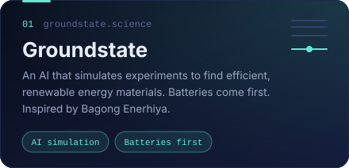
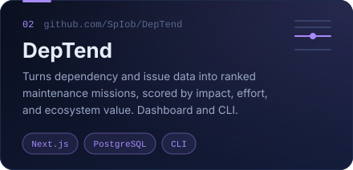
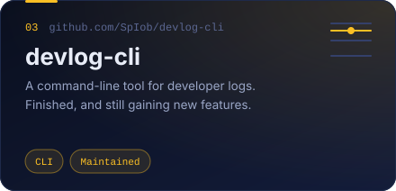
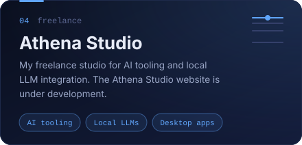
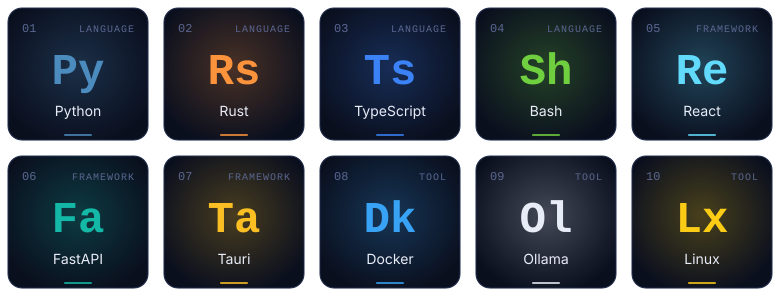

 

&nbsp;

  

 

## About

I study AI Engineering at Mapúa University, and most of what I build starts as a chore I would rather not do by hand. Some of it ends up as tools for other developers. The rest is aimed at larger questions, and Groundstate is the biggest of those so far.

Outside of class, I take on freelance work under Athena Studio, mostly AI tooling and local LLM integration.

 

## Building now

<table>
  <tr>
    <td width="50%">
      
    </td>
    <td width="50%">
      
    </td>
  </tr>
  <tr>
    <td width="50%">
      
    </td>
    <td width="50%">
      
    </td>
  </tr>
</table>

Groundstate is inspired by [Bagong Enerhiya](https://github.com/SpIob/Bagong-Enerhiya), my earlier tool for mining research literature, which pointed to an unstudied corner of Philippine renewable-energy research. That project read the papers; this one aims to simulate the experiments.

 

## Toolbox

 

Everything above started as a problem that annoyed me enough to build something.

